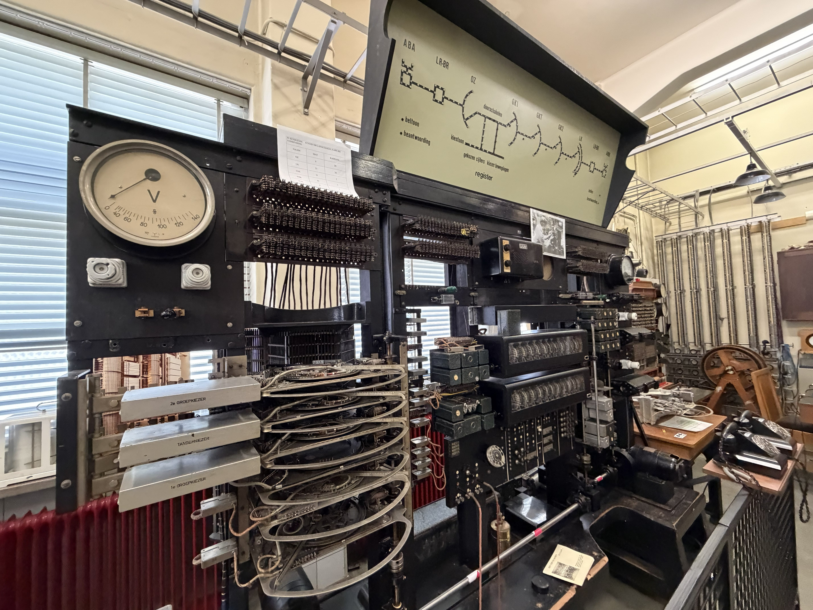
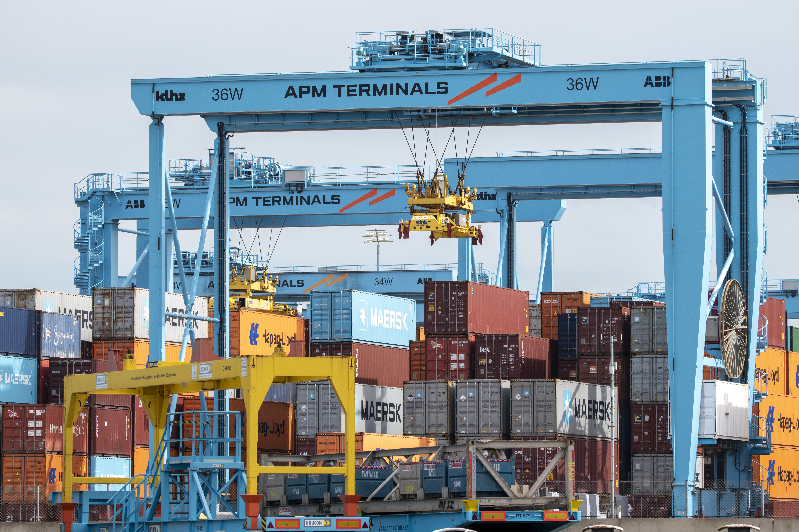
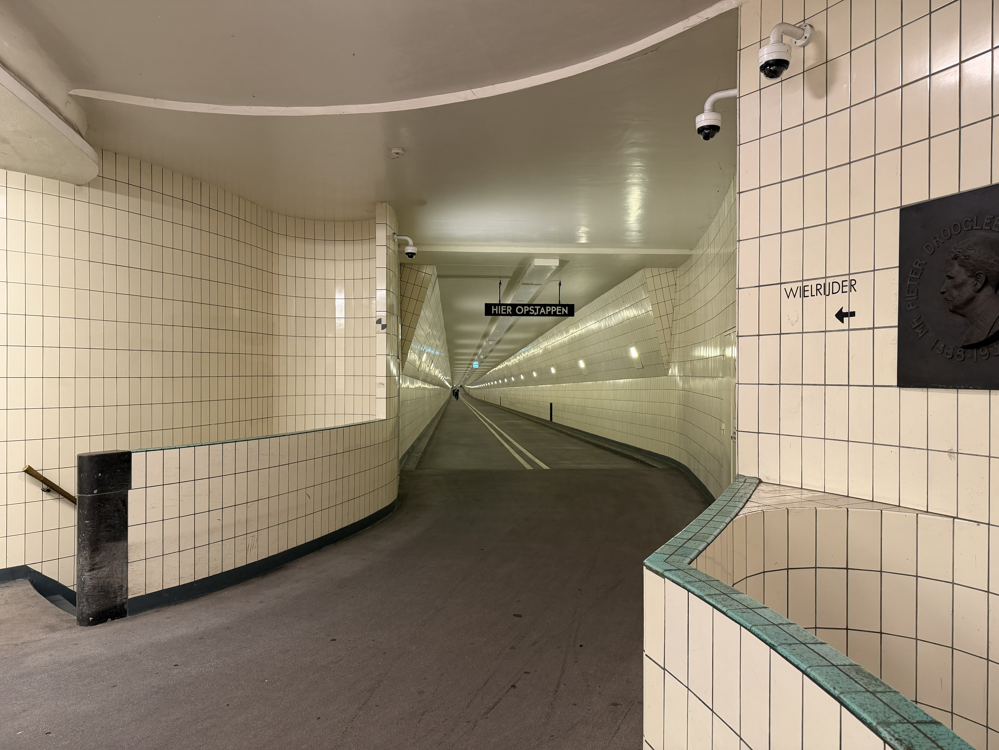
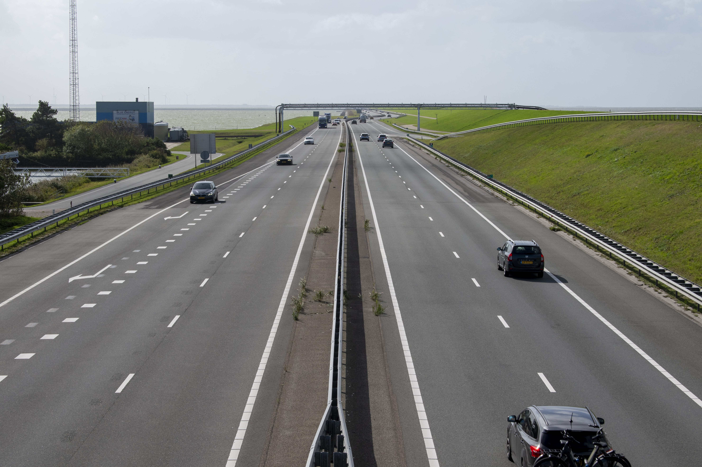
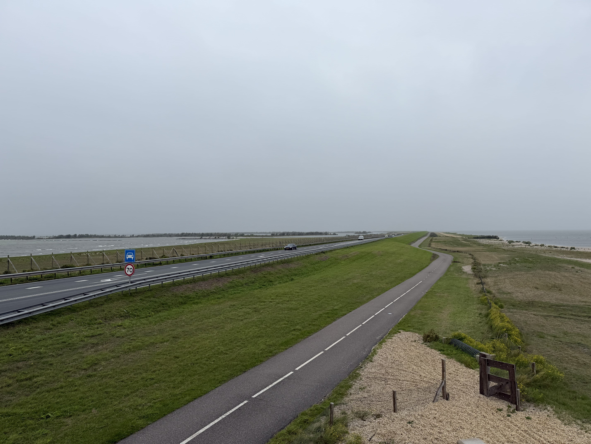
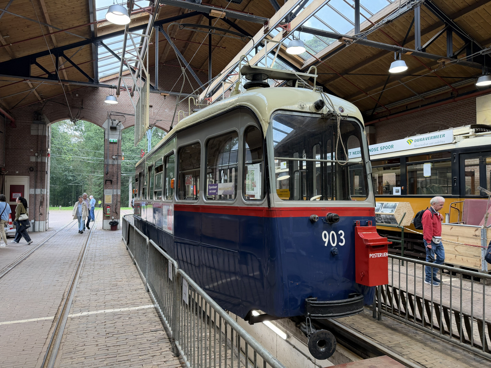
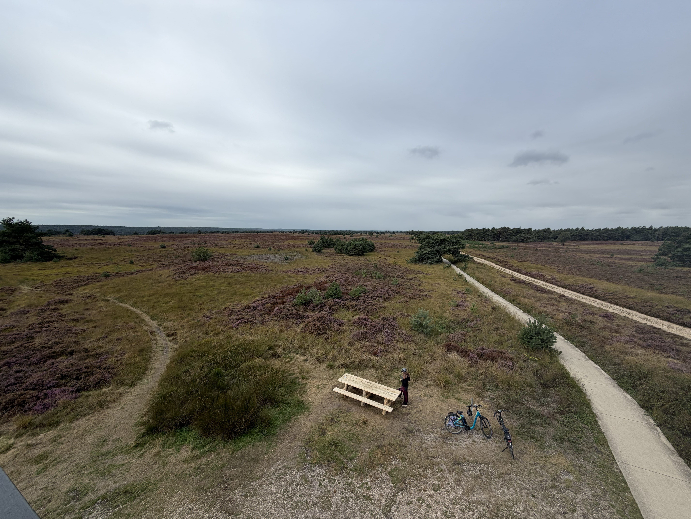
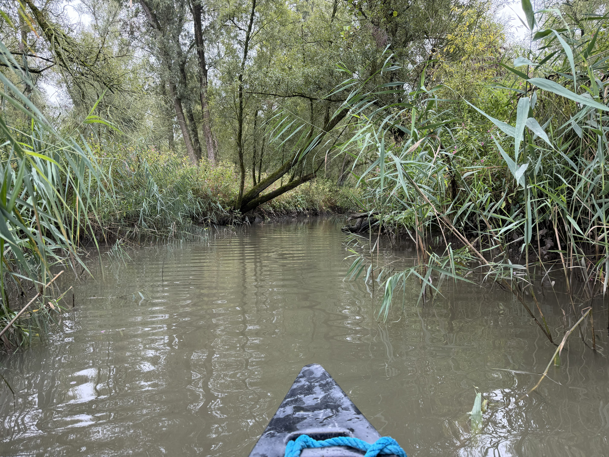
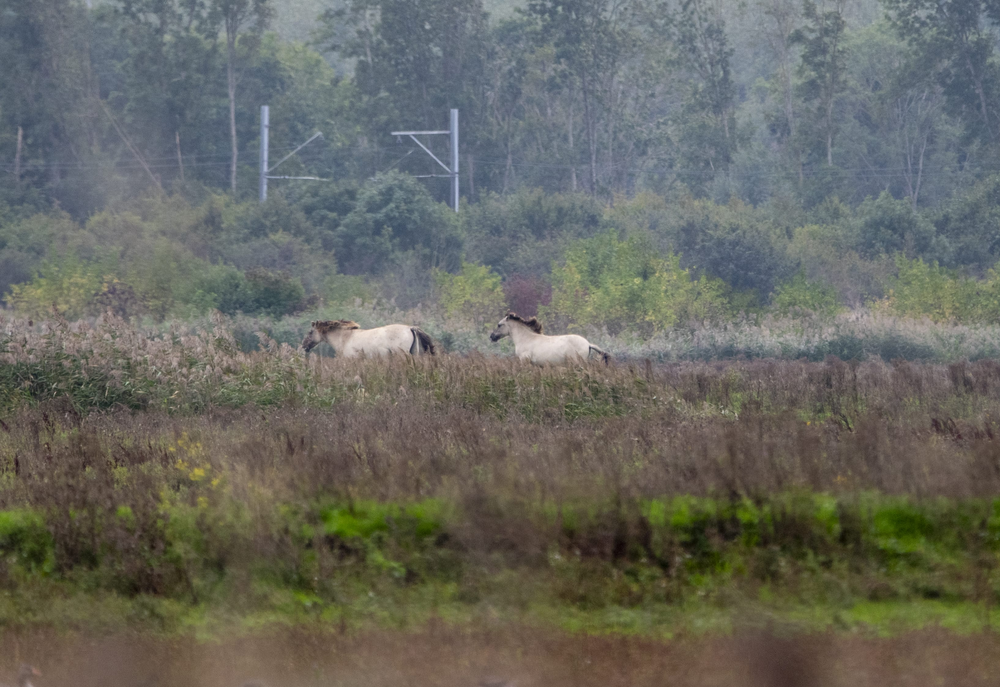

In September 2026 my partner and I traveled to the Netherlands for a holiday to enjoy Dutch infrastructure and wildlife and many other things!

We got around mostly via public transport - and you don't need to worry about tickets (unless you pre book trains for a cheaper price, but we wanted to be flexible) - all public transport (OV) services can be used by tapping in and out with contactless.

We stayed in Arnhem, Rotterdam and Alkmaar.

# Infrastructure

We visited and would recommend the following places:

**[Houweling Telecom Museum](https://www.houwelingtelecommuseum.nl/en/home-en/)** - an amazing telecommunications museum based in a telephone exchange, some of which is still in active use! As soon as we arrived a retired engineer took us on a personal guided tour of everything on offer. He had absolutely incredible knowledge of everything there, and we were able to communicate perfectly in English. 

The Telecom Museum is easily accessible via public transport from the centre of Rotterdam. It is currently open on Tuesdays. When you get to the door, it looks closed, but don't let that put you off, you need to ring the doorbell! We spent two hours here. 

**[Port of Rotterdam](https://www.portofrotterdam.com/en/portlantis/to-do/boat-trips)** - the scale of the Port of Rotterdam is hard to comprehend. The whole port is about 20 miles long! We went on a boat tour of the newer part, which requires getting to 'Portlantis', the ports visitor centre. This has a great view from the roof. I'd recommend the boat tour too, it was very cool to see massive container ships up close. 

Getting to Portlantis via public transport is a little difficult and needs some forward planning. Importantly, you cannot use services like Google Maps to plan your journey there, as a large part of the trip is made by on demand bus - and the route Google Maps shows for this is incorrect, and suggests you can just get on at stops without pre-booking.

To get there from the centre of Rotterdam, you should first book the 903 bus at _least_ 30 minutes beforehand (but you can do it days in advance, which is what we did) at the site [here](https://ebshopper.ebs-ov.nl/reserveren/3002) _NL_. Your pickup point should be Maassluis Centrum and drop off point should be Portlantis. When booking you will be told the possible arrival and drop off times - it depends if others are using the service. Note: it does not run in the mid-morning.
You can easily get to Maassluis Centrum on the metro B line from Beurs in the centre of Rotterdam. The train journey takes about 30 minutes. For us the minibus service took about 20 minutes. 

To get back to Rotterdam, do the journey above in reverse. Make sure to book the bus! It was free on the way there, and cost about €2 on the way back. The whole visit lasted half a day.

**[Maastunnel Rotterdam](https://maps.app.goo.gl/6QUqR7u2AsLRKdH5A)** - I can't go on holiday now without going underground in some way, and the Maastunnel checked that off the list! This is unlike other pedestrian tunnels I've used under rivers, because this one is actually two levels deep - the upper level is for bikes, and the lower level is for pedestrians. There is also a car tunnel. We went back through this in the other direction on the number 44 bus. The visit there and back took around an hour.

**[Afsluitdijk](https://maps.app.goo.gl/Cw3Q1uyphFuYxD3a9)** - an absolutely incredible feat of engineering, the Afsluitdijk is 20 miles long! I've never been anywhere quite like this, the views from the stops we made [1](https://maps.app.goo.gl/e5zg1M9d1ZZNS2Hy8) and [2](https://maps.app.goo.gl/qJ2raCyZXVQPLYAb6) were really quite cool, with a bridge to look over the motorway, a wind farm, and a little harbour on both sides at _1_ and a short walk to a WWII bunker at _2_. 

You can get Kibbeling from [Viscentre 't Wad](https://viscentrehetwad.nl/en/home-english/) before setting across too!

To do this, and Houtribdijk we decided renting a car would be the best option. We stayed in Alkmaar (which is lovely!) and rented from the AVIS there.
Whilst there currently is a bus that goes over Afsluitdijk, it's not very frequent, which would make stopping at lots of points more difficult. It also appears the bus has a livery that covers the windows.

Overall, we took a day to do this, but it could be much less if you just drive over and back again - but it's worth stopping at least at _1_ to get a view over the top!  

**[Houtribdijk](https://maps.app.goo.gl/fdS3YyA3AUuZnMMP6)** - this was an excellent dijk to also visit. Unlike Afsluitdijk, when driving on this one there is no large flood defense on the side which means you just see water and nothing else on your left and right! You can stop at Trintelhaven to have a view from a raised shipping container, which we did.

**[Netherlands Open Air Museum](https://www.openluchtmuseum.nl/en/)** - a popular tourist attraction in the Netherlands, which has a vintage tramway running around the edge of the site! We spent a day here looking and visiting at buildings showing the Netherlands through time. 

# Wilderness & Wildlife

**Cycling around the [Veluwezoom National Park](https://nationaleparken.nl/en/the-parks/national-park-veluwezoom)** - there is wonderful purple heather all around this national park, and renting a bike and cycling around it was a fantastic way to get around. We saw highland cattle, wild boar, deer and an absolutely beautiful landscape throughout the circular route we took. We rented electric bikes from [Veluwe Actief Posbank](https://veluweactief.nl/verhuur/) (which is good as this is quite a hilly area for the Netherlands) and spent the whole day here. 

It is easy to get to Veluwe Actief Posbank by taking a train from Arnhem to Rheden and then a short walk from the station. You should definitely have pancakes at [Pannekoekhuis Strijland](https://www.pannekoekhuisstrijland.nl/) afterwards!

**Canoeing in the [Biesbosch National Park](https://nationaleparken.nl/en/the-parks/national-park-de-biesbosch)** - this national park is a huge area of wetlands, that was really enjoyable to canoe through. The [rental desk](https://www.biesboschcentrumdordrecht.nl/en/boats) (booked in advance) gave us a map and we set off down one of the small tidal waterways, taking a circular route for two hours. We had some excellent views of the area from the canoe, and spotted a kingfisher multiple times!

After the canoe ride, we ate lunch at the canteen at the [visitor centre](https://www.biesboschcentrumdordrecht.nl/en) (which is better than expected based on reviews) and then got the passenger ferry across the water to walk around one of the islands. 

Getting to and from Biesbosch Centrum Dordrecht is difficult with public transport alone. We got a mainline train from Rotterdam to Dordrecht, and then a taxi (Lyft/Uber) to the visitor centre.

**Birdwatching in [Oostvaardersplassen](https://www.staatsbosbeheer.nl/uit-in-de-natuur/locaties/oostvaardersplassen)** _NL_ - this is a lovely area with a number of bird hides to be able to see wildlife. We saw a couple of different species of birds and wild horses. There are paved paths to get to them, which makes access quite easy. We went here after crossing the Houtribdijk by car, and spent about an hour here, before it closed for the day.

# Other recommendations

**[Pinball Museum Rotterdam](https://dutchpinballmuseum.com/gb/)** - unlike most museums, in this one you can play on most of the machines! This was a fun place to spend an afternoon, the Doctor Who pinball machine was my favourite. Accessible via public transport in Rotterdam.

# More photos

You can find more photos on my [photography website](https://wills.photography/gallery/WkkguyW2J6ptJAM95MXynO7Q).